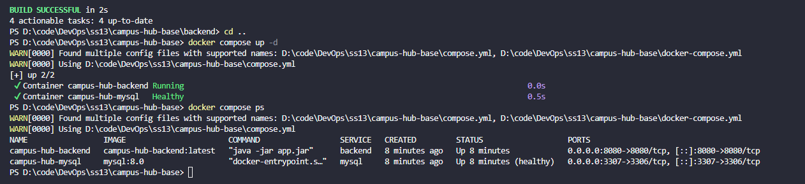
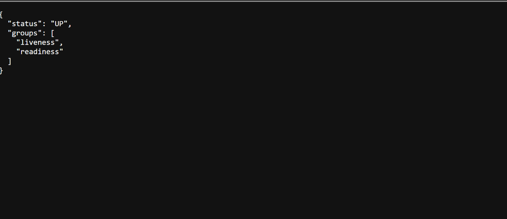

## 1. Hướng dẫn các lệnh chạy hệ thống

### Bước 1: Chạy kiểm thử và build file JAR backend
```powershell
cd backend
./gradlew test
./gradlew bootJar -x test
```

### Bước 2: Build Docker Image cho backend
```powershell
docker build -t campus-hub-backend .
```

### Bước 3: Khởi động hệ thống với Docker Compose
```powershell
cd ..
docker compose up -d
```

### Bước 4: Kiểm tra trạng thái các container
```powershell
docker compose ps
```

---

## 2. Cổng và URL kiểm tra hệ thống

- **Backend Actuator Health URL:** `http://localhost:8080/actuator/health`
- **Backend API Base URL:** `http://localhost:8080/api`
- **MySQL Host Port:** `3307` (được map từ container port `3306` để tránh trùng cổng nếu máy host đã cài MySQL)
- **Chuỗi kết nối nội bộ giữa Backend và MySQL:** `jdbc:mysql://mysql:3306/campus_hub?createDatabaseIfNotExist=true&useSSL=false&allowPublicKeyRetrieval=true`

### Lệnh kiểm tra Actuator Health endpoint:
```powershell
curl http://localhost:8080/actuator/health
```
**Kết quả HTTP Response:**
- HTTP Status: `200 OK`
- Body:
```json
{"status":"UP","groups":["liveness","readiness"]}
```

---

## 3. Ảnh chụp minh chứng kết quả làm bài

> **Lưu ý:** Chụp 3 ảnh màn hình terminal tương ứng và lưu vào thư mục `docs/images/` để hiển thị trực tiếp trên GitHub:

### Minh chứng 1: Docker Image đã build thành công
*(Ảnh chụp màn hình lệnh `docker images` hiển thị `campus-hub-backend`)*


```text
REPOSITORY            TAG       IMAGE ID       CREATED         SIZE
campus-hub-backend    latest    eb20f58de44d   10 minutes ago  405MB
```

### Minh chứng 2: Trạng thái các service sau khi chạy Compose
*(Ảnh chụp màn hình lệnh `docker compose ps` hiển thị cả `campus-hub-backend` và `campus-hub-mysql` đều UP / healthy)*



```text
NAME                 IMAGE                       COMMAND                  SERVICE   STATUS                    PORTS
campus-hub-backend   campus-hub-backend:latest   "java -jar app.jar"      backend   Up (healthy/running)      0.0.0.0:8080->8080/tcp
campus-hub-mysql     mysql:8.0                   "docker-entrypoint.s…"   mysql     Up (healthy)              0.0.0.0:3307->3306/tcp
```

### Minh chứng 3: Kết quả gọi /actuator/health
*(Ảnh chụp màn hình gọi `curl -i http://localhost:8080/actuator/health` trả về HTTP 200 và UP)*



```http
HTTP/1.1 200 OK
Content-Type: application/vnd.spring-boot.actuator.v3+json

{"status":"UP","groups":["liveness","readiness"]}
```

---

# Tài liệu gốc dự án Campus Hub Base

Campus Hub là dự án nền cho Mini Project Session 13. Ứng dụng cung cấp một không gian chung để sinh viên đăng sự kiện, tìm đồ thất lạc, hỏi đáp, trao đổi đồ dùng và tìm nhóm.

## Tài khoản mẫu
| Vai trò | Tên đăng nhập | Mật khẩu |
|---|---|---|
| Sinh viên | `student` | `student123` |
| Quản trị viên | `admin` | `admin123` |
